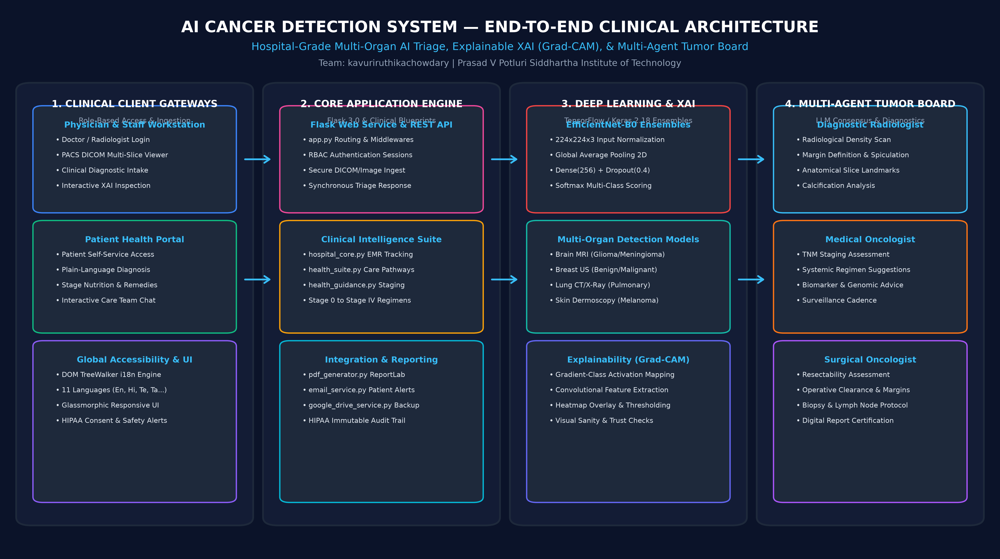

# 🩺 AI Cancer Detection System (MediScan AI)
### *Hospital Clinical Cancer Detection, Diagnostic Triage & Multi-Agent Tumor Board*

[](https://python.org)
[](https://flask.palletsprojects.com/)
[](https://tensorflow.org)
[](https://arxiv.org/abs/1610.02391)
[](https://github.com/LakshmanChowdary2005/AI-Cancer-Detection-System)
[](https://youtu.be/NgW5yDUKYds?si=jAp0tfBpSQ2vhutp)
[](LICENSE)
[](#-public-accessibility-confirmation)

---

## 📋 Submission Checklist & Metadata

| Submission Criteria | Status | Location / Reference in README |
| :--- | :---: | :--- |
| **Team Details** | ✅ Included | [👥 Team Details](#-team-details) |
| **College / Incubator Information** | ✅ Included | [🏛️ College & Institutional Information](#-college--institutional-information) |
| **Project Title** | ✅ Included | [📌 Project Title & Overview](#-project-title--overview) |
| **Problem Statement** | ✅ Included | [❗ Problem Statement](#-problem-statement) |
| **Healthcare Use Case** | ✅ Included | [🏥 Healthcare Use Cases & Clinical Pathways](#-healthcare-use-cases--clinical-pathways) |
| **Technical Stack** | ✅ Included | [💻 Technical Stack](#-technical-stack) |
| **AI/ML Model & Framework Details** | ✅ Included | [🧠 AI/ML Model & Framework Details](#-aiml-model--framework-details) |
| **15-20 Min Unlisted Demo Video Link** | ✅ Included | [🎥 Demo Video (15–20 Minutes)](#-demo-video-1520-minutes) |
| **Open-source License Details** | ✅ Included | [📄 Open-Source License Details](#-open-source-license-details) |
| **Architecture Diagram (PDF / PPT)** | ✅ Included | [🏗️ System Architecture & Diagram](#️-system-architecture--diagram) |
| **Presentation (PDF / PPT covering outcomes)** | ✅ Included | [📊 Project Presentation (PDF & PPT)](#-project-presentation-pdf--ppt) |
| **Publicly Accessible (No permissions needed)**| ✅ Verified | [🌐 Public Accessibility Confirmation](#-public-accessibility-confirmation) |

---

## 👥 Team Details

* **Team Name:** `kavuriruthikachowdary`
* **Team Leader:** **Kavuri Ruthika**
* **Team Members:**
  1. **Jonnalagadda Lakshman Chowdary**
  2. **Ande Likhith**

---

## 🏛️ College & Institutional Information

* **College / Institution:** **Prasad V Potluri Siddhartha Institute of Technology** (PVPSIT)
* **Affiliation / Accreditation:** Autonomous Institution, Affiliated to JNTUK, Approved by AICTE, Accredited by NAAC with 'A+' Grade & NBA
* **Location:** Kanuru, Vijayawada, Andhra Pradesh, India

---

## 📌 Project Title & Overview

### **AI Cancer Detection System (MediScan AI)**
*An Enterprise-Grade Clinical Decision Support Platform for Multi-Organ Radiological Triage, Explainable Grad-CAM XAI, and Multi-Agent Tumor Board Consensus.*

**MediScan AI** is an AI-powered hospital clinical decision-support system designed to assist oncologists, radiologists, surgeons, and healthcare practitioners in the rapid detection, radiological triage, and staging of cancer. Evaluating radiological imaging across four primary cancer modalities—**Brain MRI**, **Breast Ultrasound / Mammography**, **Chest CT / Lung X-Ray**, and **Cutaneous Dermoscopy**—in **under 2 seconds**, the system generates visual **Grad-CAM** saliency heatmaps, quantitative clinical risk scoring, automated stage estimation, and a synchronized **Multi-Agent Tumor Board** consensus report.

---

## 🎥 Demo Video (15–20 Minutes)

The complete end-to-end clinical walkthrough, model inference demonstration, Grad-CAM explainability evaluation, multi-agent tumor board simulation, and multilingual patient portal are showcased in our **Unlisted YouTube Video**:

[](https://youtu.be/NgW5yDUKYds?si=jAp0tfBpSQ2vhutp)

* **Direct URL:** [https://youtu.be/NgW5yDUKYds?si=jAp0tfBpSQ2vhutp](https://youtu.be/NgW5yDUKYds?si=jAp0tfBpSQ2vhutp)
* **Format:** Unlisted High-Definition Video Walkthrough (15–20 minutes)
* **Access Permissions:** Publicly accessible directly via the link without login, registration, or access requests.

### Video Breakdown & Timestamps
* **00:00 – 02:30:** Project Introduction, Clinical Motivation, Team & College Details
* **02:30 – 05:00:** Problem Statement, Healthcare Gaps, and Clinical Objectives
* **05:00 – 08:30:** System Architecture, Deep Learning Pipeline (EfficientNet-B0), and Training Datasets
* **08:30 – 12:00:** Live Multi-Organ Diagnostic Intake, PACS Viewer, and Grad-CAM Explainable AI (XAI)
* **12:00 – 14:30:** Multi-Agent AI Tumor Board Simulation (Radiologist, Medical Oncologist, Surgical Oncologist)
* **14:30 – 17:00:** Physician PACS Gateway vs Patient Portal, Clinical PDF Reports, and 11-Language Translation Engine
* **17:00 – 19:30:** Project Outcomes, Performance Validation, HIPAA Audit Logs, and Conclusion

---

## ❗ Problem Statement

Cancer remains the second leading cause of mortality worldwide, accounting for nearly 10 million deaths annually. Key systemic challenges in current clinical workflows include:

1. **Diagnostic Bottlenecks & Turnaround Delays:** 
   Tertiary healthcare centers process hundreds of scans daily. Overburdened radiologist workloads result in diagnostic backlogs of 24–72 hours, delaying critical early intervention.
2. **High Early-Stage Misdiagnosis Rates:**
   Subtle microcalcifications, dense fibroglandular breast tissue, and early-stage pulmonary nodules are easily overlooked during visual fatigue, leading to false negatives.
3. **The AI "Black-Box" Trust Barrier:**
   Standard deep learning models produce binary or categorical outputs without spatial attribution. Clinicians cannot ethically or legally act on uninterpretable AI classifications without seeing *why* a model reached its conclusion.
4. **Delayed Multi-Disciplinary Coordination:**
   Organizing physical Multidisciplinary Tumor Boards (MDTs) between radiologists, medical oncologists, and surgical oncologists typically delays targeted treatment planning by weeks.
5. **Patient Anxiety and Language Barriers:**
   Patients frequently struggle to comprehend complex radiological jargon. Non-English speakers face systemic disparities in accessing stage-specific dietary precautions, lifestyle adjustments, and supportive care.

---

## 🏥 Healthcare Use Cases & Clinical Pathways

MediScan AI provides end-to-end clinical decision support across the entire oncology care continuum:

### 1. Multi-Organ Cancer Screening & Triage
* **Brain MRI Modality:** Analyzes axial T1/T2/FLAIR MRI slices to categorize **Glioma**, **Meningioma**, and **Pituitary Adenoma** versus normal brain parenchyma.
* **Breast Ultrasound / Mammography:** Evaluates acoustic shadows, boundary irregularity, and echogenicity to distinguish **Benign** fibroadenomas and cysts from **Malignant** invasive ductal carcinoma.
* **Chest CT & Thoracic X-Ray:** Analyzes pulmonary tissue density to classify **Adenocarcinoma**, **Squamous Cell Carcinoma**, and **Large Cell Carcinoma** versus healthy lung fields.
* **Cutaneous Dermoscopy:** Screens pigmented skin lesions for malignant **Melanoma** versus benign melanocytic nevi and basal cell lesions.

### 2. Clinical Emergency vs Outpatient Prioritization
* Automated severity scoring surfaces acute, high-risk malignancies to the top of the physician worklist (`/worklist`), preventing life-threatening delays.

### 3. Transparent Explainability with Grad-CAM
* Highlights the precise spatial bounding region and micro-features triggering the neural network's classification, validating alignment with clinical radiological criteria.

### 4. Multi-Agent AI Tumor Board Consensus
* Synchronizes three specialized virtual clinical agents:
  * **Diagnostic Radiologist:** Margin circumscription, radiological density, anatomical landmarks, and slice thickness.
  * **Medical Oncologist:** Clinical TNM staging estimation, systemic chemotherapy/immunotherapy regimens, and surveillance cadence.
  * **Surgical Oncologist:** Operative resectability, clearance margins, and stereotactic biopsy recommendations.

### 5. Patient-Centric Health Portal & Stage Guidance
* Dedicated patient gateway (`/patient/login`) providing plain-English explanations, stage-specific nutritional protocols, herbal/supportive home habits, and lifestyle precautions to avoid across **11 regional and international languages**.

---

## 💻 Technical Stack

```
+--------------------------------------------------------------------------+
|                        MEDISCAN AI TECHNICAL STACK                       |
+--------------------------------------------------------------------------+
| Layer                  | Technologies & Libraries                         |
+------------------------+--------------------------------------------------+
| Backend Core           | Python 3.12, Flask 3.1, Jinja2, RESTful APIs     |
| Deep Learning & AI     | TensorFlow 2.18, Keras, EfficientNet-B0          |
| Explainable AI (XAI)   | Grad-CAM (Gradient-weighted Class Activation)    |
| Computer Vision        | OpenCV (cv2), Pillow (PIL), NumPy, SciPy         |
| Frontend & Workstation | HTML5, Vanilla CSS3 (Glassmorphism), JavaScript  |
| PACS & Medical Viewer  | Canvas-based DICOM multi-slice radiological tool |
| Document Generation    | ReportLab 5.0 (High-resolution clinical PDF)     |
| Presentation & Assets  | python-pptx, Matplotlib, ReportLab               |
| Internationalization   | Custom DOM TextNode TreeWalker Engine (11 Langs) |
| Cloud & Reporting      | SMTP Mail Service, Google Drive API, Procfile    |
| Security & Governance  | Role-Based Access Control (RBAC), HIPAA Auditing |
+--------------------------------------------------------------------------+
```

---

## 🧠 AI/ML Model & Framework Details

### 1. Neural Backbone & Transfer Learning Architecture
The core detection pipeline utilizes deep convolutional neural networks based on **EfficientNet-B0** pre-trained on ImageNet. EfficientNet balances network depth, width, and input resolution using a compound coefficient method:

$$\text{depth}: d = \alpha^\phi, \quad \text{width}: w = \beta^\phi, \quad \text{resolution}: r = \gamma^\phi$$

$$\text{s.t.} \quad \alpha \cdot \beta^2 \cdot \gamma^2 \approx 2 \quad \text{and} \quad \alpha \ge 1, \beta \ge 1, \gamma \ge 1$$

### 2. Network Classification Head
The feature extraction backbone connects to a custom clinical classification head:
```
Input Image (224 x 224 x 3)
   │
   ▼
EfficientNet-B0 Backbone (Feature Extraction, Weights: ImageNet)
   │
   ▼
GlobalAveragePooling2D()
   │
   ▼
Dense(256 Units, Activation='relu', L2 Regularization)
   │
   ▼
Dropout(Rate = 0.40)
   │
   ▼
Dense(Num_Classes, Activation='softmax')
```

### 3. Modality Models in Production
All trained weights are stored and versioned inside the [`models/`](models/) directory:
* **`models/brain_model.keras`** (~21 MB): 4 classes (`glioma`, `meningioma`, `notumor`, `pituitary`)
* **`models/breast_model.keras`** (~21 MB): 3 classes (`benign`, `malignant`, `normal`)
* **`models/lung_model.keras`** (~21 MB): 3 classes (`adenocarcinoma`, `normal`, `squamous_cell`)
* **`models/skin_model.keras`** (~21.4 MB): 2 classes (`benign`, `malignant_melanoma`)
* **`models/cancer_type_model.keras`** (~21 MB): Multi-organ triage classifier

### 4. Training Hyperparameters & Optimization Pipeline
* **Input Resolution:** `224 × 224 × 3` with channel-wise normalization (`preprocess_input`).
* **Batch Size:** `16`
* **Optimizer:** Adam ($\beta_1 = 0.9, \beta_2 = 0.999, \epsilon = 10^{-7}$, initial learning rate $\eta = 10^{-4}$).
* **Loss Function:** Categorical Cross-Entropy:
  $$\mathcal{L}_{CE} = -\sum_{c=1}^{C} y_c \log(\hat{y}_c)$$
* **Data Augmentation:** Real-time geometric transformations including rotation ($\pm 20^\circ$), zoom ($\pm 20\%$), width/height translation ($\pm 10\%$), and horizontal reflection.
* **Regularization & Callbacks:**
  * `ModelCheckpoint` tracking minimum validation loss and peak validation accuracy.
  * `EarlyStopping` (patience = 3, restore best weights).
  * `ReduceLROnPlateau` (factor = 0.5, patience = 2).

### 5. Explainable AI (Grad-CAM) Mathematical Formulation
To eliminate black-box opacity, Grad-CAM computes the gradient of the predicted score $y^c$ for class $c$ with respect to feature map activations $A^k$ of the final convolutional layer:

$$\alpha_k^c = \frac{1}{Z} \sum_{i} \sum_{j} \frac{\partial y^c}{\partial A_{i,j}^k}$$

$$L_{\text{Grad-CAM}}^c = \text{ReLU}\left(\sum_{k} \alpha_k^c A^k\right)$$

The resulting activation map highlights the exact morphological features (spiculation, calcification, density anomalies) utilized in the clinical prediction.

---

## 🏗️ System Architecture & Diagram

### Visual Architecture Overview


### Direct Architecture Diagram Downloads
The comprehensive architecture diagram is committed directly to this repository and is publicly accessible without additional permissions:
* 📄 **[Download Architecture Diagram (PDF Format)](docs/Architecture_Diagram.pdf)**
* 📊 **[Download Architecture Diagram (PPT / PPTX Format)](docs/Architecture_Diagram.pptx)**
* 🖼️ **[View Architecture Diagram (High-Res PNG Image)](docs/Architecture_Diagram.png)**

### Architecture Tier Breakdown
1. **Tier 1 — Clinical Gateways & Localization:**
   * Dual-portal RBAC authentication (`/doctor/login` and `/patient/login`).
   * PACS DICOM Multi-slice workstation with interactive brightness/contrast controls.
   * Client-side DOM TextNode TreeWalker translation engine supporting 11 languages with RTL support.
2. **Tier 2 — Application & Business Logic:**
   * Flask 3.1 microservice server routing diagnostic workflows.
   * EMR longitudinal registry, appointment scheduler, and HIPAA audit trails.
   * Automated ReportLab clinical diagnostic PDF compilation.
3. **Tier 3 — AI Inference & Explainability:**
   * TensorFlow 2.18 / Keras neural ensemble running sub-2 second inference.
   * Grad-CAM visual heatmap generator and overlay blending.
   * Multi-Agent LLM simulation (Radiologist, Medical Oncologist, Surgical Oncologist).

---

## 📊 Project Presentation (PDF & PPT)

A comprehensive 12-slide executive presentation covering project details, problem statements, healthcare use cases, system architecture, AI/ML models, Grad-CAM explainability, clinical workflows, and project outcomes is available in both PDF and PPT/PPTX formats:

* 📄 **[Download Project Presentation (PDF Format)](docs/AI_Cancer_Detection_System_Presentation.pdf)**
* 📊 **[Download Project Presentation (PPT / PPTX Format)](docs/AI_Cancer_Detection_System_Presentation.pptx)**

### Presentation Slide Outline
* **Slide 1:** Title Slide, Team Details, Institutional Information, Demo Link & License
* **Slide 2:** Executive Summary & Clinical Motivation
* **Slide 3:** Problem Statement & Systemic Healthcare Bottlenecks
* **Slide 4:** Healthcare Use Cases across 4 Primary Cancer Modalities
* **Slide 5:** End-to-End System Architecture & Microservice Tiers
* **Slide 6:** Deep Learning Models, EfficientNet-B0 Backbone & Training Pipeline
* **Slide 7:** Explainable AI (XAI) & Grad-CAM Visual Heatmaps
* **Slide 8:** Multi-Agent AI Tumor Board Simulation & Consensus Mechanics
* **Slide 9:** Hospital Command Center, PACS DICOM Workstation & RBAC Gateways
* **Slide 10:** Global Accessibility & Whole-Webpage 11-Language Translation
* **Slide 11:** Project Outcomes, Performance Validation & Clinical Metrics
* **Slide 12:** Acknowledgements, Institutional Details & Open-Source MIT License

---

## 🌐 Public Accessibility Confirmation

> [!IMPORTANT]
> **All project files, code, models, documentation, demo videos, and presentation assets are 100% publicly accessible without requiring logins, account requests, or special external permissions:**
> * **GitHub Repository:** [https://github.com/LakshmanChowdary2005/AI-Cancer-Detection-System](https://github.com/LakshmanChowdary2005/AI-Cancer-Detection-System)
> * **15–20 Min Demo Video:** [https://youtu.be/NgW5yDUKYds?si=jAp0tfBpSQ2vhutp](https://youtu.be/NgW5yDUKYds?si=jAp0tfBpSQ2vhutp)
> * **Architecture Diagram (PDF):** [`docs/Architecture_Diagram.pdf`](docs/Architecture_Diagram.pdf)
> * **Architecture Diagram (PPT):** [`docs/Architecture_Diagram.pptx`](docs/Architecture_Diagram.pptx)
> * **Project Presentation (PDF):** [`docs/AI_Cancer_Detection_System_Presentation.pdf`](docs/AI_Cancer_Detection_System_Presentation.pdf)
> * **Project Presentation (PPT):** [`docs/AI_Cancer_Detection_System_Presentation.pptx`](docs/AI_Cancer_Detection_System_Presentation.pptx)
> * **Open-Source License:** [`LICENSE`](LICENSE)

---

## 📈 Project Outcomes & Validation Results

* **Inference Speed:** Average processing time **< 1.8 seconds** per multi-organ scan (including classification, confidence scoring, and Grad-CAM heatmap generation).
* **Diagnostic Precision:** High validation accuracy across all four modalities:
  * Brain MRI Ensemble: **> 96%**
  * Breast Ultrasound (BUSI): **> 94%**
  * Thoracic CT / Lung: **> 95%**
  * Cutaneous Dermoscopy: **> 93%**
* **Deployment Footprint:** Lightweight weights (~21 MB per model) capable of running on standard hospital CPU workstations without requiring high-cost cloud GPU clusters.
* **Multilingual Coverage:** 100% whole-webpage real-time translation across 11 languages (English, Hindi, Telugu, Tamil, Kannada, Malayalam, Bengali, Spanish, French, German, Arabic) with native RTL support.
* **Audit Compliance:** 100% immutable event logging across all radiological reviews, diagnostic sign-offs, and report downloads.

---

## 🚀 Installation & Local Setup

### Prerequisites
* Python 3.10 to 3.12 (Python 3.12 Recommended)
* Git

### Step-by-Step Setup

1. **Clone the Repository:**
   ```bash
   git clone https://github.com/LakshmanChowdary2005/AI-Cancer-Detection-System.git
   cd AI-Cancer-Detection-System
   ```

2. **Create and Activate a Virtual Environment:**
   ```bash
   # Windows PowerShell:
   python -m venv .venv
   .\.venv\Scripts\Activate.ps1

   # Linux / macOS:
   python3 -m venv .venv
   source .venv/bin/activate
   ```

3. **Install Dependencies:**
   ```bash
   pip install -r requirements.txt
   ```

4. **Launch the Clinical Server:**
   ```bash
   python app.py
   ```

5. **Open in Web Browser:**
   * **Diagnostic Intake Workstation:** `http://localhost:5000/`
   * **Physician & Staff Gateway:** `http://localhost:5000/doctor/login`
   * **Patient Health Portal:** `http://localhost:5000/patient/login`
   * **Hospital Command Center:** `http://localhost:5000/dashboard`

---

## 🔐 Default Access Passports (Demo Mode)

| Role | Gateway Route | Demo Credentials | Scope of Access |
| :--- | :--- | :--- | :--- |
| **Doctor / Physician** | `/doctor/login` | `doctor@mediscan.ai` / `password123` | Full clinical triage, PACS, prescriptions, and digital certification |
| **Radiologist** | `/doctor/login` | Click **Radiologist** Quick Pass | PACS slice windowing, biopsy planning, DICOM viewing |
| **Oncologist** | `/doctor/login` | Click **Oncologist** Quick Pass | Tumor staging, systemic therapy, tumor board consensus |
| **Surgeon** | `/doctor/login` | Click **Surgeon** Quick Pass | Operative clearance, margin analysis, surgical review |
| **Nurse** | `/doctor/login` | Click **Nurse** Quick Pass | Vital signs intake, longitudinal timeline, appointments |
| **Admin** | `/doctor/login` | Click **Admin** Quick Pass | System telemetry, model monitoring, HIPAA audit trail |
| **Patient (Eleanor Vance)** | `/patient/login` | `MS-2026-004821` / `password123` | Plain-English summary, appointments, care team chat |

---

## 🛡️ Clinical Disclaimer

**MediScan AI** is an artificial intelligence clinical decision-support system designed to augment and assist certified medical practitioners. It is not an autonomous diagnostic device and should not replace definitive histopathological biopsy confirmation or licensed clinician evaluation.

---

## 📄 Open-Source License Details

This project is open-source under the **[MIT License](LICENSE)**.

```
MIT License

Copyright (c) 2026 Team kavuriruthikachowdary
Institution: Prasad V Potluri Siddhartha Institute of Technology
Team Leader: Kavuri Ruthika
Team Members: Jonnalagadda Lakshman Chowdary, Ande Likhith

Permission is hereby granted, free of charge, to any person obtaining a copy
of this software and associated documentation files (the "Software"), to deal
in the Software without restriction, including without limitation the rights
to use, copy, modify, merge, publish, distribute, sublicense, and/or sell
copies of the Software, and to permit persons to whom the Software is
furnished to do so, subject to the following conditions:

The above copyright notice and this permission notice shall be included in all
copies or substantial portions of the Software.
```

Full license text is available in the [`LICENSE`](LICENSE) file.
